# Architecture Diagram — Hospital OPD Appointment Booking Platform

**Task 08 · Domain: Healthcare · Stack: Oracle APEX 26 + ORDS + PL/SQL + Autonomous Database (23ai), Mumbai region**

Everything runs inside Oracle Cloud Infrastructure. There is no Node/Python middleware: APEX is the
presentation layer, ORDS is the API layer, and a single PL/SQL package is the business layer.

---

## 1. System architecture (layered view)

```mermaid
flowchart TB
    subgraph ACT["Users / Channels"]
        direction LR
        U1["Patient<br/>browser / mobile"]
        U2["Receptionist<br/>front desk"]
        U3["Doctor<br/>consultation room"]
        U4["Hospital Admin"]
    end

    subgraph TOOL["Test & Versioning (dev time)"]
        direction LR
        T1["Postman collection<br/>10+ assertions"]
        T2["Git / GitHub<br/>DDL · package · APEX export"]
    end

    subgraph APEX["Presentation Layer — Oracle APEX 26 (Universal Theme)"]
        direction TB
        A1["P1 Landing + Doctor Search"]
        A2["P2 Slot Selection + Hold"]
        A3["P3 Confirmation / Digital Slip"]
        A4["P4 My Bookings (self-service)"]
        A5["P5 Reception + Check-in Desk"]
        A6["P6 Doctor Consultation Desk"]
        A7["P7 Admin Master Data (IG)"]
        A8["P8 Utilisation + No-Show Reports"]
    end

    subgraph REST["API Layer — ORDS module girish.opd.api (base /v1/)"]
        direction TB
        O1["GET /departments<br/>GET /doctors<br/>GET /availability"]
        O2["POST /appointments/book"]
        O3["GET /appointments/:reference"]
        O4["PUT /appointments/cancel"]
        O5["GET /admin/appointments"]
    end

    subgraph BIZ["Business Logic Layer — PL/SQL package GIRISH_OPD_PKG"]
        direction TB
        B1["GENERATE_SLOTS<br/>template → dated slots"]
        B2["HOLD_SLOT<br/>SELECT FOR UPDATE + capacity guard"]
        B3["CONFIRM_APPOINTMENT<br/>payment + status transition"]
        B4["CHECKIN_AND_GENERATE_TOKEN<br/>daily token sequence"]
        B5["CANCEL_APPOINTMENT<br/>rule-based refund"]
        B6["RELEASE_NO_SHOWS<br/>grace-period batch"]
        B7["LOG_ERROR<br/>autonomous transaction"]
        B8["Utilisation + no-show<br/>report functions"]
    end

    subgraph DB["Data Layer — Oracle Autonomous Database (Mumbai)"]
        direction LR
        D1[("Master data<br/>DEPARTMENTS · DOCTORS<br/>SLOT_TEMPLATES · PATIENTS")]
        D2[("Transactional<br/>SLOTS · APPOINTMENTS<br/>TOKEN_QUEUE · PAYMENTS")]
        D3[("Rules + audit<br/>CANCELLATION_RULES<br/>ERROR_LOG")]
        D4["Constraints · Indexes · Sequences<br/>Views · Triggers · WHO audit columns"]
    end

    subgraph SCHED["Scheduler — DBMS_SCHEDULER"]
        direction LR
        S1["hold expiry sweep<br/>every 1 minute"]
        S2["RELEASE_NO_SHOWS<br/>every 10 minutes"]
    end

    SEC["Security<br/>APEX authentication + authorization<br/>ADMIN · STAFF · DOCTOR · PATIENT"]
    CONC["Concurrency control<br/>pessimistic: SELECT FOR UPDATE<br/>optimistic: version / status re-check"]

    U1 --> APEX
    U2 --> APEX
    U3 --> APEX
    U4 --> APEX
    T1 -->|"HTTPS / JSON"| REST
    APEX -->|"AJAX + REST-enabled regions"| REST
    APEX -->|"page processes call PL/SQL directly"| BIZ
    REST -->|"handler: PL/SQL block"| BIZ
    BIZ -->|"DML + row locks"| DB
    SCHED -->|"calls"| BIZ
    B7 -.->|"writes on failure"| D3
    SEC -.->|"protects"| APEX
    CONC -.->|"enforced in"| BIZ
    T2 -.->|"ships"| DB

    classDef actor fill:#E3F2FD,stroke:#1976D2,stroke-width:2px,color:#0D47A1
    classDef ui fill:#FFFFFF,stroke:#1976D2,stroke-width:2px,color:#0D47A1
    classDef api fill:#E8F5E9,stroke:#2E7D32,stroke-width:2px,color:#1B5E20
    classDef biz fill:#FFF3E0,stroke:#EF6C00,stroke-width:2px,color:#E65100
    classDef data fill:#EDE7F6,stroke:#4527A0,stroke-width:2px,color:#311B92
    classDef ops fill:#ECEFF1,stroke:#546E7A,stroke-width:1.5px,color:#263238
    classDef note fill:#FFFDE7,stroke:#F9A825,stroke-width:1.5px,color:#795548

    class U1,U2,U3,U4 actor
    class A1,A2,A3,A4,A5,A6,A7,A8 ui
    class O1,O2,O3,O4,O5 api
    class B1,B2,B3,B4,B5,B6,B7,B8 biz
    class D1,D2,D3,D4 data
    class S1,S2,T1,T2 ops
    class SEC,CONC note
```



---

## 2. Component responsibilities

| Layer | Component | Responsibility | Lives in |
|---|---|---|---|
| Presentation | APEX 26 app (Universal Theme) | 8 pages, role-aware navigation, booking wizard, desks, dashboards | `/apex/fXXXXX.sql` |
| API | ORDS module `girish.opd.api` | Publishes JSON endpoints, validates input, maps exceptions → HTTP codes | `/api/ords_module.sql` |
| Business | `GIRISH_OPD_PKG` | Slot generation, capacity guard, hold/confirm, tokens, cancellation, no-show sweep, error logging | `/database/girish_opd_pkg.sql` |
| Data | Autonomous Database | 10 tables, FKs, checks, indexes, sequences, views, audit triggers | `/database/ddl.sql` |
| Ops | `DBMS_SCHEDULER` jobs | Releases expired holds; flags no-shows after grace period | `/database/scheduler_jobs.sql` |
| Security | APEX auth + authorization schemes | ADMIN / STAFF / DOCTOR / PATIENT; WHO audit columns capture the actor | APEX app + DDL defaults |

---

## 3. Request paths

**Path A — patient booking through the APEX UI**

```
Browser → APEX page process → GIRISH_OPD_PKG.HOLD_SLOT → SLOTS row lock → APPOINTMENTS(HELD)
```

**Path B — external client through ORDS**

```
Postman / mobile client → HTTPS /ords/girish/v1/appointments/book
    → ORDS handler (anonymous PL/SQL block)
    → GIRISH_OPD_PKG.HOLD_SLOT(...)
    → JSON { status: 201, reference: "OPD-202611-00042" }
```

**Path C — unattended housekeeping**

```
DBMS_SCHEDULER (every 10 min) → GIRISH_OPD_PKG.RELEASE_NO_SHOWS
    → CONFIRMED appointments past grace period → NO_SHOW
    → slots.current_bookings decremented → capacity available again
```

---

## 4. Design decisions worth defending in the viva

1. **No middleware.** ORDS maps REST to PL/SQL, so every business rule stays in one place and is
   reachable from both APEX and Postman. No duplicated validation logic.
2. **One package, one transaction boundary.** Each public procedure owns its own commit/rollback and
   writes failures to `GIRISH_ERROR_LOG` through a `PRAGMA AUTONOMOUS_TRANSACTION` helper, so an
   error never loses its own log row.
3. **Rules are data, not code.** Cancellation penalties and grace periods live in tables
   (`GIRISH_CANCELLATION_RULES`), so hospital policy changes need no deployment.
4. **Capacity is enforced in the database.** `SELECT ... FOR UPDATE` on the slot row plus a capacity
   check inside the same transaction is what makes the double-booking test deterministic: the second
   concurrent request sees the committed increment and returns 409, not a duplicate booking.
5. **APEX calls PL/SQL directly for page logic; ORDS exists for external consumers.** Both paths hit
   the same package, which is why the UI and the API can never disagree.
