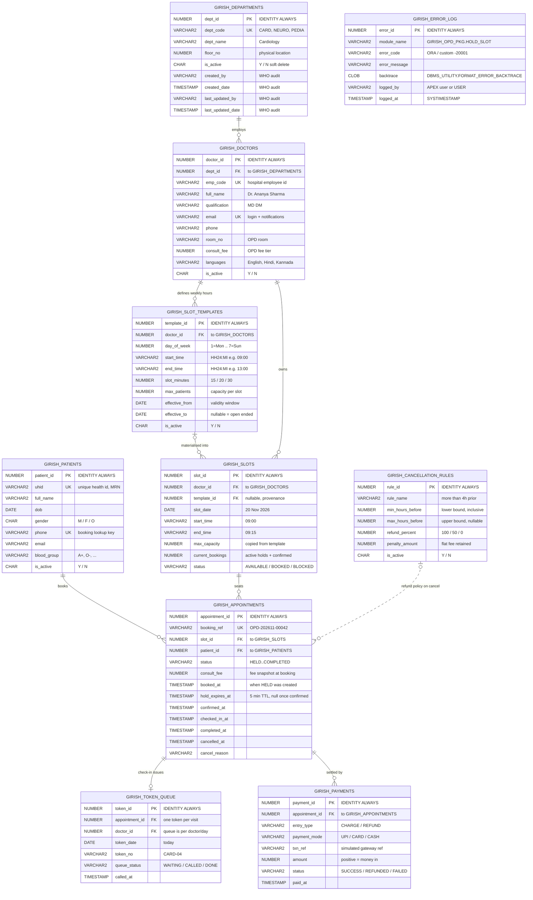

# ER Diagram — Hospital OPD Appointment Booking Platform

10 tables, all `GIRISH_` prefixed, in 3NF, with WHO audit columns on every row
(`CREATED_BY`, `CREATED_DATE`, `LAST_UPDATED_BY`, `LAST_UPDATED_DATE`) and soft delete via `IS_ACTIVE`.

---

## 1. Entity–relationship diagram



---

## 2. Relationship summary

| # | Parent | Child | Cardinality | FK / rule |
|---|---|---|---|---|
| 1 | `DEPARTMENTS` | `DOCTORS` | 1 : N | `DOCTORS.DEPT_ID` — `ON DELETE RESTRICT` |
| 2 | `DOCTORS` | `SLOT_TEMPLATES` | 1 : N | `TEMPLATES.DOCTOR_ID` — `ON DELETE CASCADE` |
| 3 | `SLOT_TEMPLATES` | `SLOTS` | 1 : N (optional) | `SLOTS.TEMPLATE_ID` nullable — generated rows survive template edits |
| 4 | `DOCTORS` | `SLOTS` | 1 : N | `SLOTS.DOCTOR_ID` — `ON DELETE CASCADE` |
| 5 | `PATIENTS` | `APPOINTMENTS` | 1 : N | `APPOINTMENTS.PATIENT_ID` — `ON DELETE RESTRICT` |
| 6 | `SLOTS` | `APPOINTMENTS` | 1 : N | `APPOINTMENTS.SLOT_ID`; `N = SLOTS.MAX_CAPACITY` |
| 7 | `APPOINTMENTS` | `TOKEN_QUEUE` | 1 : 0..1 | `TOKEN_QUEUE.APPOINTMENT_ID` **UNIQUE** |
| 8 | `APPOINTMENTS` | `PAYMENTS` | 1 : N | append-only ledger: one `CHARGE` + optional `REFUND` |
| 9 | `CANCELLATION_RULES` | `APPOINTMENTS` | logical (no FK) | resolved by hours-before-slot at cancel time |

The dashed line for rule 9 is deliberate: cancellation policy is **configuration**, matched by a
range predicate, not a physical foreign key. That is what lets the hospital change refund bands
without touching code.

---

## 3. Why `APPOINTMENTS` has no `DOCTOR_ID`

The doctor is reachable through `SLOT_ID → SLOTS.DOCTOR_ID`. Storing it again would create a
transitive dependency (`SLOT_ID → DOCTOR_ID`), which is a 3NF violation, and would allow rows where
the appointment's doctor disagrees with the slot's doctor. Reports join
`APPOINTMENTS → SLOTS → DOCTORS` (an inner join — a concept the rubric asks to demonstrate).

`CONSULT_FEE` **is** duplicated on the appointment, intentionally: it is a historical snapshot of
what the patient was charged, and must not change when the doctor's current fee changes.

---

## 4. Key constraints and indexes

| Object | Definition | Purpose |
|---|---|---|
| `UK_SLOTS_DOC_TIME` | `UNIQUE (DOCTOR_ID, SLOT_DATE, START_TIME)` | one physical slot per doctor per time; makes `GENERATE_SLOTS` re-runnable |
| `UK_APPT_REF` | `UNIQUE (BOOKING_REF)` | reference is the public handle used by every endpoint |
| `UK_PATIENT_PHONE` / `UK_PATIENT_UHID` | unique | prevents duplicate patient records from reception |
| `UK_TOKEN_DOC_DATE_NO` | `UNIQUE (DOCTOR_ID, TOKEN_DATE, TOKEN_NO)` | token numbers never repeat within a doctor's day |
| `UK_TOKEN_APPT` | `UNIQUE (APPOINTMENT_ID)` on `TOKEN_QUEUE` | check-in is idempotent |
| `CK_SLOT_STATUS` | `STATUS IN ('AVAILABLE','BOOKED','BLOCKED')` | slot state machine |
| `CK_APPT_STATUS` | `STATUS IN ('HELD','CONFIRMED','CHECKED_IN','COMPLETED','CANCELLED','NO_SHOW','EXPIRED')` | appointment state machine |
| `CK_SLOT_CAPACITY` | `CURRENT_BOOKINGS BETWEEN 0 AND MAX_CAPACITY` | last line of defence against overbooking |
| `CK_PATIENT_GENDER` | `GENDER IN ('M','F','O')` | matches data-standard rule |
| `CK_RULE_RANGE` | `REFUND_PERCENT BETWEEN 0 AND 100` | sane refund configuration |
| `IX_APPT_PATIENT` | `(PATIENT_ID, BOOKED_AT DESC)` | "My Bookings" page |
| `IX_APPT_STATUS_DATE` | `(STATUS, BOOKED_AT)` | no-show sweep + admin filters |
| `IX_SLOT_DOC_DATE` | `(DOCTOR_ID, SLOT_DATE, STATUS)` | availability lookup (the hottest query) |
| `IX_TOKEN_DOC_DATE` | `(DOCTOR_ID, TOKEN_DATE, QUEUE_STATUS)` | doctor's live queue |
| `IX_PAY_APPT` | `(APPOINTMENT_ID)` | slip / receipt lookup |

Sequences: `SEQ_BOOKING_REF` (reference numbers), `SEQ_TOKEN_NO` (daily token), plus identity
columns for surrogate keys. Business references are generated with a sequence, never `MAX()+1`.

---

## 5. Concurrency contract (how the diagram stays true under load)

```
HOLD_SLOT:
  SELECT MAX_CAPACITY, CURRENT_BOOKINGS, STATUS
    FROM GIRISH_SLOTS WHERE SLOT_ID = p_slot_id
     FOR UPDATE;                       -- pessimistic row lock, one waiter at a time
  IF STATUS <> 'AVAILABLE' OR CURRENT_BOOKINGS >= MAX_CAPACITY THEN
     RAISE e_slot_full;                -- → 409 Conflict
  END IF;
  UPDATE GIRISH_SLOTS SET CURRENT_BOOKINGS = CURRENT_BOOKINGS + 1 ...
  INSERT INTO GIRISH_APPOINTMENTS (..., STATUS, HOLD_EXPIRES_AT)
       VALUES (..., 'HELD', SYSTIMESTAMP + INTERVAL '5' MINUTE);
  COMMIT;
```

`CK_SLOT_CAPACITY` guarantees that even a future code path that forgets the lock cannot write a
slot over capacity. Optimistic control is used where a lost update is harmless (e.g. admin edits,
via `LAST_UPDATED_DATE` comparison before `UPDATE`).

---

## 6. Audit, soft delete and error handling

- **WHO columns** — defaults `SYSDATE` and
  `COALESCE(SYS_CONTEXT('APEX$SESSION','APP_USER'), USER)`, refreshed by a `BEFORE UPDATE` trigger so
  `LAST_UPDATED_BY/DATE` can never be spoofed by application code.
- **Soft delete** — `IS_ACTIVE = 'N'` on master tables; slots and appointments are never deleted, only
  status-transitioned, so utilisation history stays intact.
- **Error log** — every public package procedure wraps its body in `EXCEPTION WHEN OTHERS` and calls
  `LOG_ERROR` (autonomous transaction), so a failed booking still leaves a trace after the caller's
  `ROLLBACK`.
