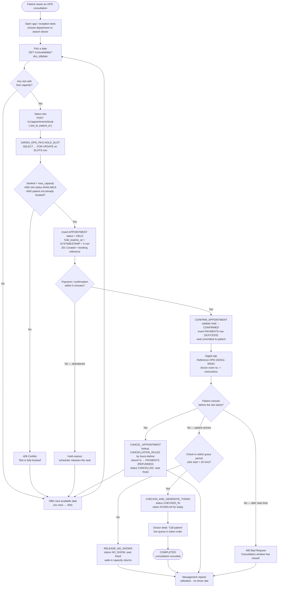
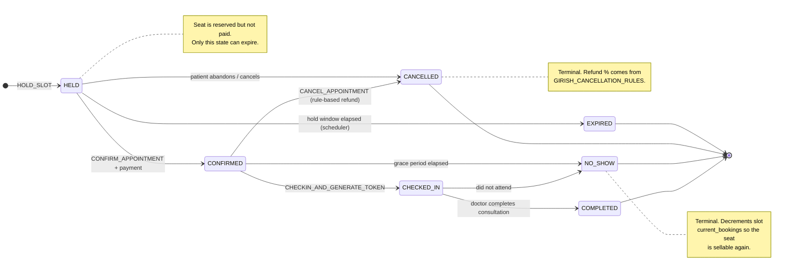

# Process Flow Diagram — Hospital OPD Appointment Booking Platform

Two views of the same process:

1. **End-to-end flow** — what happens from "patient needs a doctor" to "consultation completed",
   including every branch the rubric tests (sold out, abandoned hold, cancellation, no-show).
2. **Appointment lifecycle** — the status machine the database enforces.

---

## 1. End-to-end booking, check-in and consultation flow

---

## 2. Appointment lifecycle (status machine)

### Slot status machine (separate, simpler)

| Slot status | Meaning | Becomes |
|---|---|---|
| `AVAILABLE` | Generated, has free capacity | `BOOKED` when `current_bookings` reaches `max_capacity` |
| `BOOKED` | At capacity — no new holds accepted | `AVAILABLE` again after a cancellation / no-show / hold expiry |
| `BLOCKED` | Doctor unavailable (leave, emergency, admin block) | `AVAILABLE` only by admin action |

---

## 3. Change of state → who is allowed to trigger it

| Transition | Actor | Entry point | DB effect |
|---|---|---|---|
| — → `HELD` | Patient / Receptionist | `POST /appointments/book`, P2 wizard | `APPOINTMENTS` insert, `SLOTS.current_bookings + 1` |
| `HELD` → `CONFIRMED` | Patient / Receptionist | `POST /appointments/confirm`, P3 | `PAYMENTS` insert, `hold_expires_at` cleared |
| `HELD` → `EXPIRED` | Scheduler | job `GIRISH_HOLD_EXPIRY_JOB` | `current_bookings - 1` |
| `CONFIRMED` → `CHECKED_IN` | Receptionist | `PUT /appointments/checkin`, P5 | `TOKEN_QUEUE` insert, `checked_in_at` set |
| `CHECKED_IN` → `COMPLETED` | Doctor | P6 button | `completed_at` set |
| `CONFIRMED` → `NO_SHOW` | Scheduler | job `GIRISH_NO_SHOW_JOB` | `current_bookings - 1` |
| `HELD`/`CONFIRMED` → `CANCELLED` | Patient / Staff / Admin | `PUT /appointments/cancel`, P4 | refund row, `current_bookings - 1` |

---

## 4. Design note — where capacity is actually reserved

The blueprint's wording has `CONFIRM_APPOINTMENT` increment the slot counter. For the concurrency
test to be deterministic, reserve the seat at **hold** time instead (increment under the
`SELECT ... FOR UPDATE` lock) and release it on expiry / cancel / no-show. `CONFIRM` then only flips
the status and writes the payment row. With one counter shared by holds and confirmed bookings, two
simultaneous requests on a capacity-1 slot can never both pass the check — one gets `201`, the other
`409`, every run.
